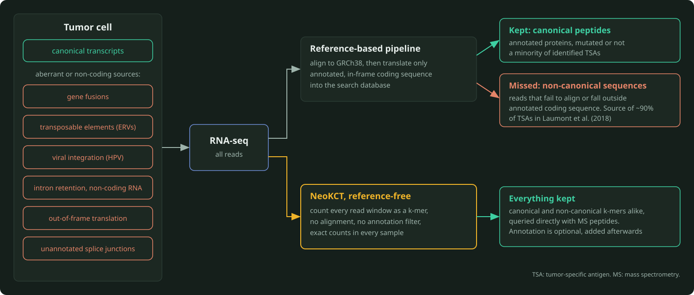
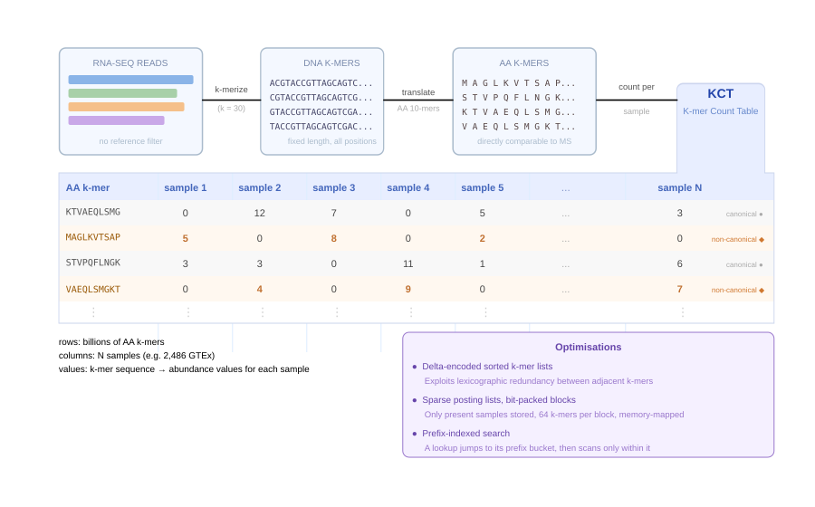
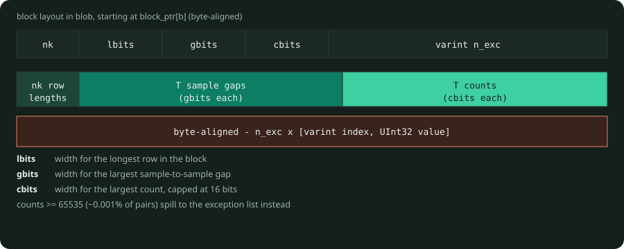
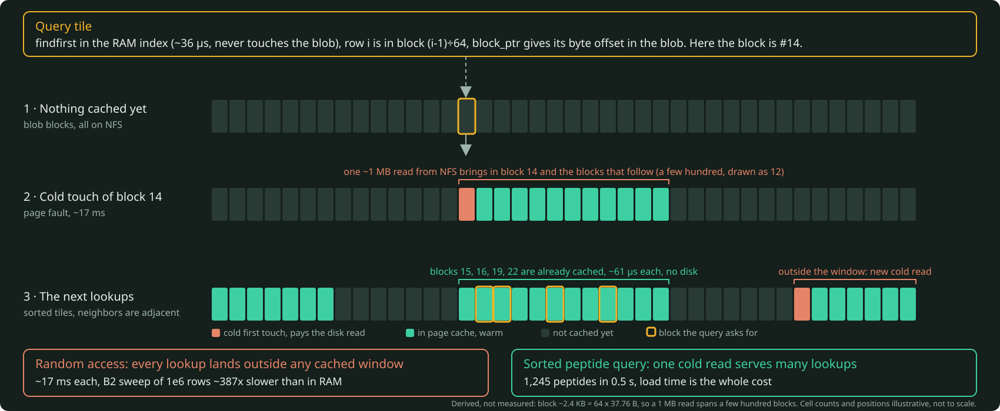
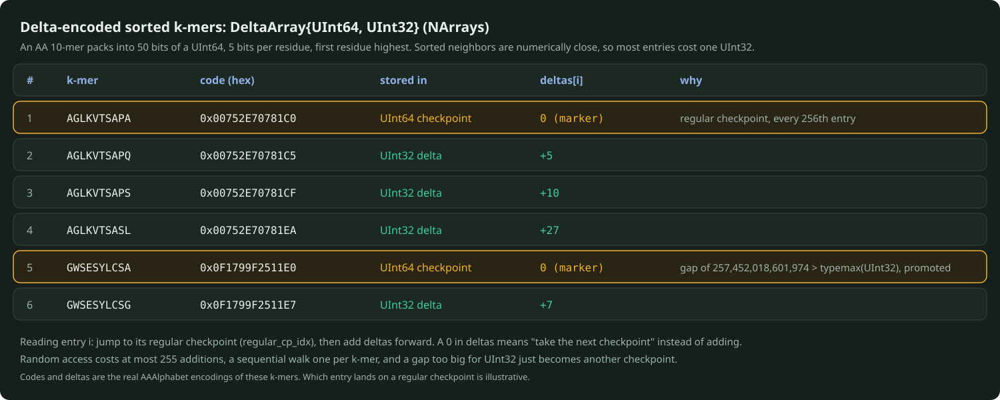
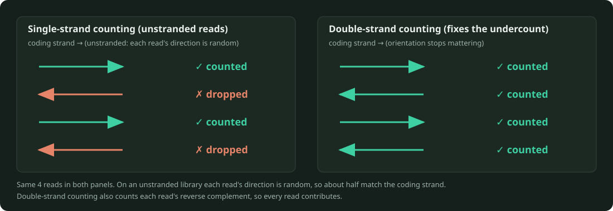
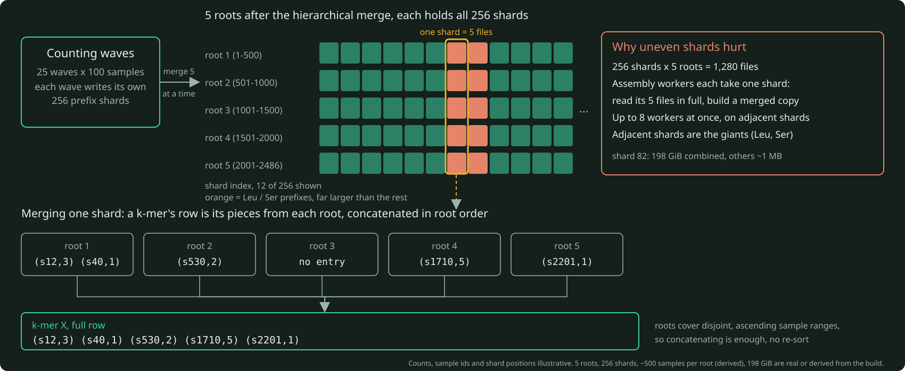
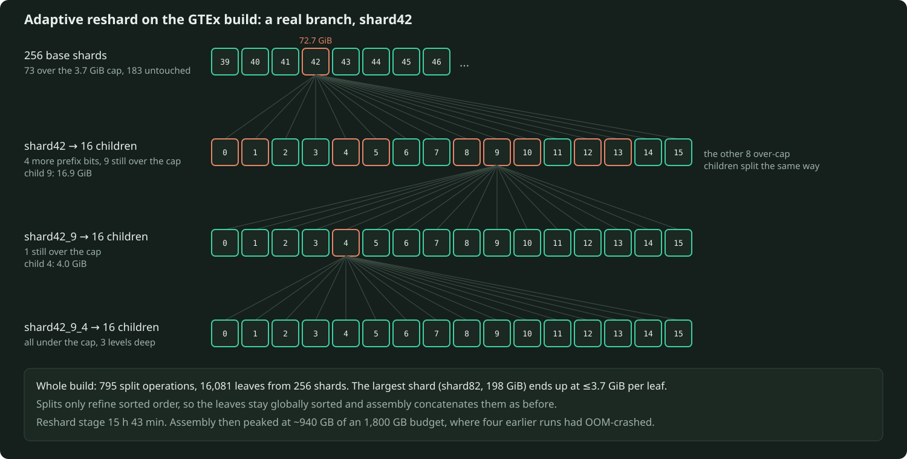

# NeoKCT
 
**Neo K-mer Count Table** is a reference-free, memory-efficient framework for transcriptomic profiling at scale.
 
---
 
## Motivation
 
Reference-based analyses discard non-aligning reads, overlooking biologically important elements such as alternative open reading frames and aberrantly expressed tumor-specific antigens (aeTSAs). Systematic discovery of these sequences requires reference-free methods that scale to modern transcriptomic datasets comprising hundreds to thousands of RNA-Seq samples.
 
NeoKCT is built around a memory-efficient k-mer count table that holds billions of k-mers and their exact per-sample counts, supports parallel traversal across large sample cohorts, and enables rapid reconstruction of transcriptomic profiles. By joining a table of sequenced aeTSA peptides with a table of RNA-Seq samples, one can find the origin of each peptide across thousands of samples entirely without reference alignment, enabling unbiased discovery of non-canonical transcripts for immunopeptidomics and transcriptomics applications.

In practice this holds real cohorts. The current production table is a double-strand, amino-acid (10-mer) build of 2,486 GTEx RNA-seq samples:

| | GTEx, double-strand AA build |
|---|---|
| Samples | 2,486 |
| Distinct k-mers | 62,563,538,826 |
| (sample, count) pairs | 909,720,444,747 |
| File size | 2.15 TiB (37.76 bytes per k-mer) |
| K-mer lookup, 1 thread, location only | 24.8 µs |
| Full session, 1,245 peptides x 2,486 samples | 45.6 min, almost all of it table load |
| Build peak memory, final assembly | ~940 GB, on a single machine |

On a same-alphabet benchmark (200 GTEx samples, DNA 31-mers, Jellyfish counts as ground truth), NeoKCT returned the exact count for 98.12% of queried k-mers, against 9.82% for REINDEER.


 
---
 
## How It Works

A table is built by a disk-backed streaming merge, regardless of cohort size (`build_kct_streaming`, `StreamBuild.jl`):

```
RNA-Seq FASTQ / CRAM, hundreds to thousands of samples
        │
        ▼
  count in waves  (JelloFish.jl: rolling 2-bit counter, per-sample retry,
        │          optional translation and double-strand counting)
        │  one sample's hash table in RAM at a time
        ▼
  scatter to prefix-sharded record files  (local scratch disk)
        │
        ▼
  fold each wave into a partial table  (sorted k-mers + per-shard dedup)
        │
        ▼
  hierarchical merge, interleaved with the wave loop
        │  fires every merge_fanin waves, deletes its inputs as it completes
        ▼
  adaptive reshard  (prefix tree)
        │  splits only oversized shards by extra prefix bits, until every leaf is under a size cap
        ▼
  streaming-transcode assembly
        │  no dedup dictionary, the packed blob streams to disk and is never buffered whole
        ▼
  KCT{K, Ab, CountsLayer}  V4.0, read-only
        block-compressed sparse-count posting lists, memory-mapped on load
        │
        ├──▶ peptide_counts / peptide_matrix  (PeptideQuery.jl)
        │      per-sample peptide abundance, rphm-normalized with SampleMeta
        │
        ├──▶ setdiff(tumor, normal; pred)  (KCTLayers.jl)
        │      O(n+m) tumor-vs-normal anti-join on two tables
        │
        ▼ (optional enrichment)
  add_biotypes(kct, gidx)  (KCTLayers.jl)
        │  O(n+m) sorted merge walk against KCT{BiotypLayer}
        ▼
  KCT{CountsLayer, BiotypLayer}  → per-k-mer counts + biotype bitmask


Ensembl transcript FASTA(s) + GTF / GFF3 (+ optional proteome FASTA)
        │
        ▼
  build_genomic_index  (GenomicIndexBuilder.jl)
        │  k-merize transcripts, OR-accumulate biotype bits per k-mer,
        │  optional "in_frame_cds" bit from the proteome
        ▼
  KCT{BiotypLayer}  (sorted k-mers, deduplicated bitmask pool, prefix index)
```

Peak memory stays flat in the number of samples through counting, scattering, and merging. Only the final assembly is cohort-sized, and even it streams its output rather than holding the whole table in RAM. The reshard stage exists because k-mer prefixes are far from uniform in real data (leucine and serine dominate amino-acid prefixes through codon degeneracy), so a fixed 256-way prefix split left some shards close to 200 GB combined while most were around a megabyte. Waves, merges and reshard splits leave resumability markers, so a killed build picks back up without recounting finished work. See `build_kct_streaming`'s docstring in `StreamBuild.jl` for the full keyword list, and `ARCHITECTURE.md` for the design rationale behind every stage.

The resulting table is read-only: `push!`, `collapse!`, `sort!` and `repack` all raise an error on it. Add more samples by re-running `build_kct_streaming` over the full sample list (it resumes) or by seeding it from an existing table with the `seeds` keyword. To correct a single sample's counts in an already-assembled table, `patch_sample_counts` rewrites it in one streaming pass into a new file.


Once built, the table is a sorted list of amino-acid (or DNA) k-mers, each with its own per-sample counts:


 
---
 
## Key Technical Features
 
- **Block-compressed sparse-count posting lists** (`CountsLayer`, in `KCTLayers.jl`): the representation `build_kct_streaming` produces, and the only counts representation this project uses. Each k-mer keeps its own list of the samples where it was seen, as `(sample, count)` pairs, and absent samples are never stored. Sample indices within a list are gap-coded against the previous entry. K-mers are grouped into fixed blocks of 64, and each block picks a single bit width for its row lengths, its sample gaps, and its counts (the minimum that fits that block), with a short per-block exception list for counts that do not fit 16 bits. There is deliberately no cross-k-mer deduplication. Measurement on real RNA-seq showed the rows holding almost all of the pairs are effectively unique, so a shared pool plus a per-k-mer pointer cost about what it saved and needed a multi-terabyte build-time dictionary to maintain. A `block_ptr` offset array gives random access to any k-mer's block without a scan.

  
- **Memory-mapped loading**: `load_kct` memory-maps the packed blob by default, so resident memory is the k-mer index plus whatever blocks a query has touched. On the GTEx table that is about 265 GB resident for a 2.15 TiB file. The first touch of a block pays a disk read (around 17 ms on the lab's NFS mount, against ~61 µs once cached), but a real peptide query touches sorted, adjacent k-mers, so most reads land on pages already cached. `load_kct(path; in_memory=true)` reads the whole blob into RAM instead, which avoids cold reads for heavy random access when the blob fits in memory.

  
- **Delta-encoded k-mer sequences** (`DeltaArray`): sorted k-mer bit-patterns stored as delta-encoded integers (UInt64 values, UInt32 deltas by default), roughly halving sequence storage. Periodic checkpoints bound random access to O(checkpoint interval), and sequential iteration is O(1) amortized. Overflow deltas are transparently promoted to checkpoints. Both the checkpoint type `C` and delta type `D` are type parameters, allowing compact alternatives for small tables.

  `DeltaArray` is provided by the [`NArrays`](https://github.com/lemieux-lab/NArrays) package (originally developed for this project).

  
- **Layered architecture**: a `KCT{K, Ab, Counts, Biotype, C, D}` is a wrapper combining up to three independent layers. `KmerLayer` holds the sorted k-mer sequences and prefix index. `CountsLayer` holds the count table. `BiotypLayer` holds the deduplicated biotype bitmask pool. Layers can be added or omitted independently, folding the old `NeoKCT`, `RichKCT`, and `GenomicIndex` types into one. Cross-layer operations (`add_biotypes`, `setdiff`) are defined at the `KCT` level on top of a single O(n+m) sorted merge walk.
- **Prefix-indexed search**: an index keyed on the leading k-mer symbols (5 by default for amino acids) partitions the sorted k-mer list into buckets, so a lookup jumps straight to the right bucket. Within each bucket, `DeltaArray.searchfirst` does an in-order scan without full decode.
- **Peptide queries** (`PeptideQuery.jl`): `peptide_counts(kct, pep)` returns a peptide's per-sample abundance against an amino-acid table. A peptide shorter than K sums its whole prefix range of k-mers (adjacent in sorted order, decoding each touched block once), a peptide of exactly K is its own row, and a longer peptide takes the elementwise minimum over its overlapping K-mer tiles. `il_ambiguous=true` sums over every isoleucine/leucine variant, since the two are isobaric. `peptide_matrix` runs a whole peptide set across threads. Two documented blind spots: a peptide at the very C-terminus of its ORF returns zero for lengths below K (no stop-free extension), and matching is exact, as in BamQuery.
- **rphm normalization** (`SampleMeta.jl`): `read(io, SampleMeta)` loads a sample manifest (slot, sample id, tissue, library size) and `rphm(M, meta)` converts a peptide matrix to reads per hundred million, BamQuery's unit, so values compare directly against its 8.55 rphm threshold. Library sizes live in this external manifest and are not stored in the `.kct` file.
- **Parallel k-merization**: a rolling 2-bit k-mer counter reads a chunk of sequence with no per-k-mer allocation (`count_kmers`), and `chunk_stream` fans chunks out to worker tasks behind a bounded semaphore so an unbounded backlog can't build up. `jello_superthreaded_hash` merges the per-chunk tables in parallel.
- **DNA k-mers by default, amino acid translation optional**: `JelloFish.jl`'s counter reads raw nucleotide k-mers. Passing `translate=true` folds each in-frame codon to a 5-bit amino acid symbol as it goes (`K` nucleotides become `K÷3` amino acids), for peptide-level queries. `build_kct_streaming` honors the same flag.
- **Double-strand counting**: `double_strand=true` also counts each read's reverse complement into the same table. Without it, a read only counts when it happens to match the coding strand, which on an unstranded library (GTEx, for one) drops about half the real signal. It has to happen at counting time, because once reads are folded to amino-acid k-mers the reverse strand can't be recovered. `build_kct_streaming` honors the flag. The default stays `false` so older builds reproduce exactly.

  
- **Disk-backed streaming build** (`build_kct_streaming`, `StreamBuild.jl`): an external k-way merge sort (Knuth-style). Samples are counted in waves and scattered into k-mer-prefix-sharded record files on local scratch disk, each wave is folded into a sorted partial table, and partials are combined by a hierarchical merge that runs interleaved with the wave loop, firing every `merge_fanin` waves and deleting its inputs as it completes, so live partials on disk stay bounded instead of growing with the cohort. An adaptive prefix-tree reshard then splits any shard whose size across the merge roots exceeds `reshard_leaf_bytes` (default 4 GB) by `reshard_extra_bits` more prefix bits, recursively, leaving small shards untouched. On the GTEx build that split 73 of 256 shards into 16,081 leaves and capped the largest from 198 GiB to under 3.7 GiB. The final assembly transcodes the leaves directly into block-compressed posting lists with no dedup dictionary, streaming the packed output to disk rather than buffering the whole table in RAM. Each sample's count is retried (`count_attempts`) if it throws, which covers transient samtools / FIFO / NFS failures without failing the whole run. Every stage marks itself done, so `resume = true` (the default) picks a killed build back up without redoing finished work.

  

  
- **Single-sample patching** (`patch_sample_counts`): replaces one sample's contribution in an assembled table with a corrected recount, in one streaming pass that decodes and re-encodes each block once. It updates rows where both have the k-mer, adds rows only the recount has, scrubs the old count where only the table has it, and writes a new file without touching the input. Built after a transient glitch undercounted one GTEx sample, where a full rebuild would have taken around 10 days.
- **Biotype annotation layer** (`BiotypLayer`): one or more Ensembl transcript FASTAs and a GTF or GFF3 annotation are k-merized into a `KCT{Nothing, BiotypLayer}`, a sorted table of amino-acid k-mers, each tagged with a bitmask whose bits flag which transcript biotypes (protein-coding, lncRNA, and so on) cover that k-mer. Multiple biotypes for the same k-mer are OR-accumulated. An optional proteome FASTA (`proteome_path`) adds an `in_frame_cds` bit marking k-mers from annotated proteins, which separates canonical in-frame k-mers from out-of-frame ones without parsing CDS coordinates. Calling `add_biotypes(kct, gidx)` performs an O(n+m) sorted merge walk and returns a `KCT{CountsLayer, BiotypLayer}`, which exposes `counts + biotype_mask` per k-mer. K-mers absent from the reference receive an intergenic mask.
- **Tumor-vs-normal anti-join**: `setdiff(tumor, normal; pred)` walks two count tables in one sorted pass and returns the tumor k-mers that satisfy `pred(tumor_row, normal_row)`, where `normal_row` is `nothing` for a k-mer never seen in the normal table. The default predicate is plain set difference. A count-aware predicate gives exact-count k-mer arithmetic in the style of Laumont et al. (2018).
- **Versioned binary serialization**: every KCT variant is written and read through a single `write_kct` / `load_kct` pair, in the current v4.0 format with a `layers_mask` header byte. A legacy `GenomicIndex` v1.0 `.gidx` file loads and upgrades to the current `KCT` type automatically via `load_gidx`. Earlier NeoKCT/RichKCT file formats (v1.2 through v3.0) are no longer readable. Check out the `V4.0-last-retrocompat` tag to read one of those.
- **Progress and memory logging**: long-running loops (`peptide_matrix`, `setdiff`, `add_biotypes`, every build stage) log progress, rate, ETA and current RSS through a shared `_Prog` reporter, so a run heading for an OOM shows itself in the log within minutes.
 
---
 
## Requirements
 
- **Julia** 1.12+
 
Key dependencies (see `Project.toml`):
 
| Package | Purpose |
|---|---|
| `NArrays` | `DeltaArray`, parallel sort (registered in the lab's [`LabRegistry`](https://github.com/lemieux-lab/LabRegistry)) |
| `BioSequences` / `BioSymbols` | Biological sequence types |
| `Kmers` | K-mer representation and encoding |
| `BitIntegers` | Wide integer types for k-mer codes |
| `GZip` | Compressed FASTQ support |
| `EzXML` | mzid (proteomics) file parsing |
| `JSON` | Benchmark history and Jellyfish dump headers |
| `ProgressMeter` | Progress bars |
| `Mmap` / `Dates` (stdlib) | Memory-mapped table loading, log timestamps |
 
Install dependencies from the repo root, after adding the lab registry so `NArrays` resolves:
 
```julia
using Pkg
Pkg.Registry.add(RegistrySpec(url="https://github.com/lemieux-lab/LabRegistry.git"))
Pkg.activate(".")
Pkg.instantiate()
```

Run the test suite with `Pkg.test()` from the activated environment (also run by CI on every push).
 
---
 
## Quick Start
 
```julia
include("src/NeoKCT.jl")  # or include("Main.jl"), which does this and `using .NeoKCT`
using .NeoKCT

samples = ["s1.fastq.gz", "s2.fastq.gz", # ... hundreds to thousands more
           "s2486.fastq.gz"]

# Peak memory stays flat in the number of samples. Only the final assembly is
# cohort-sized, and even that streams its packed output to disk. Every stage
# marks itself done, so re-running the same call after a crash or a kill
# resumes instead of recounting.
out_path = build_kct_streaming(
    samples;
    K = 30,                # nucleotide k-mer length
    translate = true,      # true: in-frame amino acid (K÷3)-mers. false (default): raw DNA k-mers
    double_strand = true,  # also count each read's reverse complement (unstranded libraries)
    wave_size = 100,       # samples counted and folded together per wave
    shard_bits = 8,        # 2^8 = 256 k-mer-prefix shards
    merge_fanin = 5,       # partials combined together per hierarchical merge step
    reshard_leaf_bytes = 4_000_000_000,  # split any shard over this size before assembly
    tmp_dir = "/scratch",  # LOCAL disk for wave scatter files, not NFS
    out_dir = "output/",
)

# The table is read-only: push!, collapse!, sort!, and repack all error on it.
kct = load_kct(out_path)  # count blob is memory-mapped by default (in_memory=true reads it in)

# Index a k-mer (returns Kmer => count_vector across samples)
i = findfirst(kct, kmer_bits)
kct[i]

# Peptide abundance across every sample, then normalized to rphm
counts = peptide_counts(kct, "SIINFEKL")
M = peptide_matrix(kct, ["SIINFEKL", "GILGFVFTL"]; il_ambiguous = false)
meta = open(io -> read(io, SampleMeta), "sample_manifest.tsv")  # slot, sample_id, tissue, primary_reads
R = rphm(M, meta)

# Tumor k-mers absent from a normal table (or any count-aware predicate)
tumor_only = setdiff(tumor_kct, normal_kct)

# Build a KCT{BiotypLayer} from Ensembl transcript FASTA + annotation (GTF or GFF3)
gidx = build_genomic_index("Homo_sapiens.GRCh38.cdna.all.fa.gz", "Homo_sapiens.GRCh38.110.gtf.gz", 30;
                           proteome_path = "Homo_sapiens.GRCh38.pep.all.fa.gz")

# Serialize / deserialize the genomic index
write_kct(gidx, "grch38.kct")
gidx = load_kct("grch38.kct")

# Load an older .gidx file (automatically upgraded to KCT{BiotypLayer})
gidx = load_gidx("grch38.gidx")

# Enrich a KCT with biotype annotations
rich = add_biotypes(kct, gidx)
write_kct(rich, "my_table_rich.kct")

# Index a k-mer in an enriched KCT (returns Kmer => (counts, biotype_mask))
i = findfirst(rich, kmer_bits)
rich[i]  # => kmer => (; counts, biotype)

# Query biotype membership for a given k-mer
biotype_names_for(rich.biotype, i)   # e.g. ["protein_coding", "lncRNA", "in_frame_cds"]
has_biotype(rich.biotype, i, "protein_coding")

# Replace one sample's counts with a corrected recount, writing a new file
fixed = jello_superthreaded_hash("s289.fastq.gz", 30; translate = true, double_strand = true)
patch_sample_counts(out_path, 289, fixed, "output/neokct_v4_patched.kct")
```

See the keyword list in `build_kct_streaming`'s docstring (`StreamBuild.jl`) for seeding from an existing table (`seeds`), a custom per-sample `counter` (the GTEx build streams CRAMs through `samtools fastq`, see `build_scripts/build_kct_gtex_cram_streaming.jl`), retry behaviour on a flaky counter (`count_attempts`), and the resumability flag (`resume`, on by default).

---
 
## Project Layout
 
| File | Description |
|---|---|
| `src/NeoKCT.jl` | Module entry point. Includes `KCTLayers.jl`, which includes every other source file |
| `src/KCTLayers.jl` | All layer structs (`KmerLayer`, `CountsLayer`, `BiotypLayer`), `KCT` wrapper, block codec, cross-layer logic (`add_biotypes`, `setdiff`) |
| `src/StreamBuild.jl` | `build_kct_streaming`: waves, prefix-sharded scatter, hierarchical merge, adaptive reshard, streaming-transcode assembly, per-sample retry. Also `stream_kct_as_shards` (seeding) and `patch_sample_counts` |
| `src/JelloFish.jl` | Parallel k-merization and counting from FASTQ, optional translation and double-strand counting |
| `src/PeptideQuery.jl` | `peptide_counts`, `peptide_matrix`, prefix-range `searchsorted` on a `KmerLayer` |
| `src/SampleMeta.jl` | Sample manifest reader and `rphm` normalization |
| `src/Progress.jl` | `_Prog` progress reporter and `_log`, with RSS in every line |
| `src/AAAlphabet.jl` | Custom 5-bit amino acid alphabet for `BioSequences` |
| `src/KCTLoader.jl` | Binary serialization / deserialization (v4.0 native, retrocompat GenomicIndex v1.0). Memory-maps the count blob by default |
| `src/JellyfishDump.jl` | Parser for Jellyfish's own binary dump format, plus DNA-to-AA translation into a KCT-ready hash |
| `src/KCTBenchmarker.jl` | Component-size and query-speed benchmarking, JSON history |
| `src/BioParser.jl` | Unified reader for FASTQ, gzipped FASTQ, mzid, FASTA, GTF, and GFF3 files |
| `src/GenomicIndexBuilder.jl` | `build_genomic_index`: builds a `KCT{BiotypLayer}` from Ensembl transcript FASTA + GTF/GFF3, optional in-frame CDS bit |
| `test/runtests.jl` | Test suite (round trips, streaming build, reshard, patching, counting, peptide queries) |
| `build_scripts/` | Production build entrypoints, including the GTEx CRAM streaming build |
| `ARCHITECTURE.md` | Full design rationale for every structure and build stage. Read it before changing build internals |
| `Main.jl` | Convenience loader for scripts and the REPL |
| `NArrays` (package) | `DeltaArray`, `psort!`, `psortperm` |
 
---
 
## Stability Notice
 
This project is under active development. The data structure layout, file format, and API are subject to change. No stable public API is guaranteed at this stage. A manuscript describing NeoKCT and its GTEx-scale application is in preparation.
